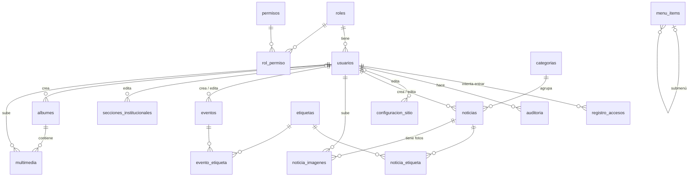

# Base de datos

Guía completa de la base `alcaldia_db`: qué guarda cada tabla, cómo se
conectan, en qué orden se muestran los datos y qué reglas debe cumplir
**cualquier backend** que se conecte a ella (Python, PHP, Node…).

- Motor: MySQL 8, InnoDB, `utf8mb4` (tildes, ñ y emojis).
- Archivos: `backend/database/schema.sql` (estructura) y `backend/database/seed.sql` (datos iniciales).
- Diseño original del equipo: `db/Create DB Alcaldiadb.sql` (dbdiagram), corregido en `schema.sql`.

**Contenido**
1. [Cómo crearla](#1-cómo-crearla)
2. [Mapa general](#2-mapa-general)
3. [Orden de creación de las tablas](#3-orden-de-creación-de-las-tablas)
4. [Tablas en detalle](#4-tablas-en-detalle)
5. [Cómo se conectan (claves foráneas)](#5-cómo-se-conectan-claves-foráneas)
6. [Ordenamiento de los datos](#6-ordenamiento-de-los-datos)
7. [Reglas para cualquier backend](#7-reglas-para-cualquier-backend)
8. [Consultas de referencia](#8-consultas-de-referencia)
9. [Datos iniciales](#9-datos-iniciales)
10. [Límites conocidos](#10-límites-conocidos)

---

## 1. Cómo crearla

**MySQL Workbench:** abrir `schema.sql` y ejecutarlo completo (⚡). Después,
lo mismo con `seed.sql`. Los dos traen `CREATE DATABASE` / `USE alcaldia_db`.
Luego copiar las imágenes de ejemplo de `backend/database/semillas/img/` a
`backend/app/static/uploads/noticias/`.

**Consola (desde `backend/`):** hace todo lo anterior.
```bash
python -m scripts.init_db           # crea lo que falte (no borra)
python -m scripts.init_db --reset   # BORRA todo y lo vuelve a crear
```

Los dos archivos usan `IF NOT EXISTS` / `INSERT IGNORE`: se pueden ejecutar
varias veces sin duplicar nada.

---

## 2. Mapa general

18 tablas y 1 vista, agrupadas en 6 módulos.



| Módulo | Tablas |
| --- | --- |
| Usuarios y seguridad | `roles`, `permisos`, `rol_permiso`, `usuarios`, `registro_accesos`, `auditoria` |
| Sitio | `configuracion_sitio`, `menu_items` |
| Noticias | `categorias`, `etiquetas`, `noticias`, `noticia_etiqueta`, `noticia_imagenes` |
| Eventos | `eventos`, `evento_etiqueta` (usa `etiquetas`) |
| Institucional | `secciones_institucionales` |
| Galería | `albumes`, `multimedia` |
| Vista | `v_noticias_publicadas` |

**Convenciones en todas las tablas**

| Columna | Significado |
| --- | --- |
| `id` | Clave primaria autoincremental |
| `slug` | Versión del título apta para URL (`inauguracion-de-la-galeria`). Única. |
| `estado` | `borrador` (no visible), `publicada` (visible), `archivada` (no visible, se conserva) |
| `activo` | `TRUE`/`FALSE` para encender o apagar sin borrar (roles, categorías, menú, secciones) |
| `orden` | Número para ordenar a mano: menor primero |
| `creado_por` / `actualizado_por` | Qué usuario creó / editó por última vez |
| `creado_en` / `actualizado_en` | Fechas automáticas. `actualizado_en` cambia sola en cada `UPDATE`. |
| `eliminado_en` | **Borrado lógico**: `NULL` = existe; con fecha = eliminado (no se muestra, pero sigue en la base) |

---

## 3. Orden de creación de las tablas

Una tabla con clave foránea solo se puede crear después de la tabla a la que
apunta. `schema.sql` las crea en este orden:

| # | Tabla | Necesita que exista antes |
| --- | --- | --- |
| 1 | `roles` | — |
| 2 | `permisos` | — |
| 3 | `rol_permiso` | roles, permisos |
| 4 | `usuarios` | roles |
| 5 | `registro_accesos` | usuarios |
| 6 | `auditoria` | usuarios |
| 7 | `configuracion_sitio` | usuarios |
| 8 | `menu_items` | (sí misma) |
| 9 | `categorias` | — |
| 10 | `etiquetas` | — |
| 11 | `noticias` | categorias, usuarios |
| 12 | `noticia_etiqueta` | noticias, etiquetas |
| 13 | `noticia_imagenes` | noticias, usuarios |
| 14 | `eventos` | usuarios |
| 15 | `evento_etiqueta` | eventos, etiquetas |
| 16 | `secciones_institucionales` | usuarios |
| 17 | `albumes` | usuarios |
| 18 | `multimedia` | albumes, usuarios |
| — | vista `v_noticias_publicadas` | noticias, categorias |

Los **datos** (`seed.sql`) siguen el mismo orden: roles → permisos →
rol_permiso → usuario Sistema → configuración → menú → categorías →
etiquetas → noticias → noticia_etiqueta.

Para **borrar todo a mano** se va al revés (o simplemente `DROP DATABASE alcaldia_db;`).

---

## 4. Tablas en detalle

### 4.1 Usuarios y seguridad

#### `roles`
Tipos de usuario del panel: **administrador**, **editor**, **periodista**.
- `nombre` único. `activo = FALSE` desactiva el rol: sus usuarios no pueden entrar.
- Un rol no guarda permisos directamente; los recibe por `rol_permiso`.

#### `permisos`
Lista de acciones que se pueden hacer en el panel.
- `codigo` único con formato **`modulo.accion`**: `noticias.crear`, `eventos.eliminar`, `usuarios.editar`…
- `modulo` agrupa los permisos para mostrarlos en pantalla.
- Acciones usadas: `ver`, `crear`, `editar`, `publicar`, `eliminar`.

#### `rol_permiso`
Tabla intermedia (muchos a muchos): qué permisos tiene cada rol.
- Clave primaria compuesta `(rol_id, permiso_id)`: un permiso no se repite en un rol.
- Para dar o quitar un permiso a un rol se inserta o borra una fila aquí.

#### `usuarios`
Cuentas que entran al panel. El portal público no necesita usuario.

| Columna | Uso |
| --- | --- |
| `rol_id` | Rol del usuario (uno solo) |
| `email` | Único. Es el usuario para iniciar sesión. Guardarlo en minúsculas. |
| `password_hash` | Hash bcrypt (o Argon2). **Nunca** la contraseña en texto. |
| `activo` | `FALSE` = no puede entrar |
| `debe_cambiar_clave` | `TRUE` = al entrar se le obliga a cambiar la contraseña |
| `intentos_fallidos` | Contraseñas incorrectas seguidas |
| `bloqueado_hasta` | Si es una fecha futura, no puede entrar hasta entonces |
| `ultimo_acceso` | Última vez que entró |
| `eliminado_en` | Borrado lógico |

#### `registro_accesos`
Una fila por **cada intento de inicio de sesión**, bueno o malo.
- `usuario_id` es `NULL` si el correo no existe; `email_intentado` guarda lo que se escribió.
- `ip` y `user_agent` (navegador) para detectar ataques.
- Sirve para limitar intentos por IP y por correo, y para mostrar un historial.
- Solo se inserta, nunca se edita.

#### `auditoria`
Bitácora de **quién hizo qué, sobre qué registro y cuándo**.
- `accion`: crear, editar, eliminar, publicar, despublicar, archivar, login, logout, login_fallido, cambio_rol, cambio_clave.
- `tabla` + `registro_id`: sobre qué fila fue (ej. `noticias`, 12).
- `datos_anteriores` / `datos_nuevos`: JSON con el estado antes y después. **Nunca** incluir `password_hash`.
- Solo se inserta, nunca se edita ni se borra.

### 4.2 Sitio

#### `configuracion_sitio`
Textos y datos generales del portal en formato **clave → valor**.
- La clave primaria es `clave` (texto): `nombre_sitio`, `lema`, `logo`, `direccion`, `telefono`, `correo`, `facebook`, `instagram`, `x`, `rif`…
- Para agregar un dato nuevo al sitio basta con insertar una fila; no hay que cambiar la estructura.
- El portal la lee completa una vez y la usa en el Header y el Footer.

#### `menu_items`
Enlaces del menú principal.
- `parent_id`: `NULL` = enlace principal; con un id = submenú de ese enlace.
- `ruta` única (`/cultura`). `orden` define la posición. `activo` lo oculta sin borrarlo.
- Si se borra un enlace padre, sus submenús se borran con él.

### 4.3 Noticias

#### `categorias`
Secciones de noticias: Cultura, Turismo, Mundo, País, Eventos, Deportes.
- `nombre` y `slug` únicos. El `slug` forma la URL (`/cultura`).
- `orden` define cómo aparecen en menús y filtros. `activo = FALSE` la oculta.
- No se puede borrar una categoría que tenga noticias (hay que moverlas o desactivarla).

#### `etiquetas`
Palabras clave **compartidas** por noticias y eventos ("Cultura", "Obras", "Comunidad").
- `nombre` y `slug` únicos. Se identifican por `slug`: "Economía", "economia" y "ECONOMÍA" son la misma etiqueta.
- Una etiqueta existe una sola vez aunque la usen cien noticias.

#### `noticias`
El contenido principal del portal.

| Columna | Uso |
| --- | --- |
| `categoria_id` | Sección a la que pertenece (una sola) |
| `titulo`, `subtitulo` | Título y resumen |
| `slug` | URL única. Se genera al crear y **no cambia** al editar el título, para no romper enlaces. |
| `contenido` | Texto. Párrafos separados por una línea en blanco. |
| `imagen` | **Imagen principal (portada)**: la de las tarjetas, el inicio y el ticker |
| `autor` | Firma visible ("Prensa Alcaldía"). No es lo mismo que `creado_por`. |
| `destacada` | `TRUE` = sale en el ticker de titulares |
| `estado` | borrador / publicada / archivada |
| `publicada_en` | Fecha de publicación. Se llena **la primera vez** que se publica y no cambia después. |
| `creado_por`, `actualizado_por` | Usuario que la cargó / la editó por última vez |
| `eliminado_en` | Borrado lógico |

#### `noticia_etiqueta`
Tabla intermedia (muchos a muchos) entre noticias y etiquetas.
- Clave primaria `(noticia_id, etiqueta_id)`: una noticia no repite una etiqueta.
- Una noticia puede tener varias etiquetas, y una etiqueta, varias noticias.

#### `noticia_imagenes`
**Imágenes adicionales** de una noticia (fotos dentro del artículo).

| Columna | Uso |
| --- | --- |
| `noticia_id` | Noticia a la que pertenece |
| `archivo` | Nombre del archivo guardado en el servidor. Único dentro de la misma noticia. |
| `descripcion` | Pie de foto. También sirve de texto alternativo (accesibilidad). |
| `orden` | Posición: 1, 2, 3… |
| `subido_por` | Usuario que la subió |

**Cuántas imágenes puede tener una noticia**

| Caso | `noticias.imagen` | Filas en `noticia_imagenes` | Total |
| --- | --- | --- | --- |
| Noticia simple | 1 (portada) | 0 | 1 |
| Noticia con galería | 1 (portada) | 3 a 5 | 4 a 6 |
| Máximo | 1 (portada) | 5 | **6** |

- La portada **no** se repite en `noticia_imagenes`.
- MySQL no limita cuántas filas tiene cada noticia: **el backend debe rechazar la sexta imagen adicional**.
- Si la noticia se borra físicamente, sus filas se borran solas (`CASCADE`). Con borrado lógico se conservan.

### 4.4 Eventos

#### `eventos`
Agenda municipal: actividades con lugar y fecha.
- `fecha_inicio` obligatoria. `fecha_fin` opcional (eventos de varios días). Si existe, debe ser mayor o igual que `fecha_inicio` (lo valida el backend).
- Mismos `slug`, `estado`, `creado_por` / `actualizado_por` y borrado lógico que las noticias.
- `imagen`: una imagen del evento.

#### `evento_etiqueta`
Igual que `noticia_etiqueta`, pero para eventos. Usa la misma tabla `etiquetas`,
así una etiqueta como "Cultura" agrupa noticias **y** eventos.

### 4.5 Institucional

#### `secciones_institucionales`
Páginas fijas de la alcaldía: misión, visión, historia, alcalde, símbolos, contacto.
- `clave` única: el portal pide cada sección por su clave (`mision`, `historia`…).
- `orden` define el orden en la página Institucional. `activo` oculta una sección.
- No tiene borrador: se edita directo. `actualizado_por` registra quién la cambió.

### 4.6 Galería

#### `albumes`
Álbumes de fotos de la galería pública ("Feria de Betijoque 2026").
- `portada`: imagen de la tarjeta del álbum.
- `estado` y borrado lógico como las noticias.

#### `multimedia`
Fotos y videos de cada álbum.
- `tipo`: `imagen` o `video`. `url`: archivo subido o enlace (por ejemplo, YouTube).
- `orden` define la posición dentro del álbum.
- Si se borra el álbum, su multimedia se borra con él.

> **¿`multimedia` o `noticia_imagenes`?** `multimedia` es para la galería
> pública (álbumes). `noticia_imagenes` es para las fotos que van dentro de
> una noticia. No se mezclan.

### 4.7 Vista `v_noticias_publicadas`

Consulta guardada con las noticias que el público **sí** puede ver:
`estado = 'publicada'`, `eliminado_en IS NULL` y categoría activa, junto con
el nombre y el slug de la categoría. La API pública puede leer de aquí en lugar
de repetir esos filtros.

---

## 5. Cómo se conectan (claves foráneas)

| Desde | Hacia | Relación | Al borrar el registro de destino |
| --- | --- | --- | --- |
| `usuarios.rol_id` | `roles.id` | muchos usuarios → 1 rol | **Impide** borrar un rol con usuarios |
| `rol_permiso.rol_id` | `roles.id` | intermedia | Se borran sus filas (`CASCADE`) |
| `rol_permiso.permiso_id` | `permisos.id` | intermedia | `CASCADE` |
| `registro_accesos.usuario_id` | `usuarios.id` | muchos → 1 | Queda `NULL` (se conserva el registro) |
| `auditoria.usuario_id` | `usuarios.id` | muchos → 1 | Queda `NULL` |
| `configuracion_sitio.actualizado_por` | `usuarios.id` | muchos → 1 | Queda `NULL` |
| `menu_items.parent_id` | `menu_items.id` | submenú → menú | `CASCADE` (se borran los submenús) |
| `noticias.categoria_id` | `categorias.id` | muchas noticias → 1 categoría | **Impide** borrar la categoría |
| `noticias.creado_por` | `usuarios.id` | muchas → 1 | **Impide** borrar el usuario |
| `noticias.actualizado_por` | `usuarios.id` | muchas → 1 | Queda `NULL` |
| `noticia_etiqueta.noticia_id` | `noticias.id` | intermedia | `CASCADE` |
| `noticia_etiqueta.etiqueta_id` | `etiquetas.id` | intermedia | `CASCADE` |
| `noticia_imagenes.noticia_id` | `noticias.id` | muchas fotos → 1 noticia | `CASCADE` |
| `noticia_imagenes.subido_por` | `usuarios.id` | muchas → 1 | **Impide** borrar el usuario |
| `eventos.creado_por` | `usuarios.id` | muchos → 1 | **Impide** |
| `eventos.actualizado_por` | `usuarios.id` | muchos → 1 | Queda `NULL` |
| `evento_etiqueta.evento_id` | `eventos.id` | intermedia | `CASCADE` |
| `evento_etiqueta.etiqueta_id` | `etiquetas.id` | intermedia | `CASCADE` |
| `secciones_institucionales.actualizado_por` | `usuarios.id` | muchas → 1 | Queda `NULL` |
| `albumes.creado_por` | `usuarios.id` | muchos → 1 | **Impide** |
| `multimedia.album_id` | `albumes.id` | muchas → 1 álbum | `CASCADE` |
| `multimedia.subido_por` | `usuarios.id` | muchas → 1 | **Impide** |

**Por qué "impide" en los usuarios:** el contenido debe conservar a su autor.
Por eso a un usuario no se le borra la fila: se le pone `activo = FALSE` o
`eliminado_en = NOW()` (borrado lógico).

---

## 6. Ordenamiento de los datos

Cómo debe ordenar cada listado el backend (cláusula `ORDER BY`):

| Listado | Orden | Por qué |
| --- | --- | --- |
| Noticias en el portal | `publicada_en DESC, id DESC` | La más reciente primero; `id` desempata |
| Noticias en el panel | `COALESCE(publicada_en, creado_en) DESC, id DESC` | Los borradores no tienen `publicada_en`; se usa su fecha de creación |
| Ticker de titulares | `destacada = TRUE`, `publicada_en DESC`, con `LIMIT` | Solo destacadas, las más nuevas |
| Imágenes de una noticia | portada primero; luego `noticia_imagenes.orden ASC, id ASC` | El editor decide el orden |
| Etiquetas de una noticia | `etiquetas.nombre ASC` | Alfabético |
| Etiquetas más usadas | `COUNT(*) DESC, nombre ASC` | Para sugerirlas en el formulario |
| Categorías | `orden ASC, nombre ASC` | Orden manual |
| Menú | `parent_id`, luego `orden ASC` | Primero los principales, cada submenú bajo su padre |
| Eventos próximos | `fecha_inicio ASC` con `fecha_inicio >= NOW()` (o `fecha_fin >= NOW()`) | El más cercano primero |
| Eventos pasados | `fecha_inicio DESC` | El más reciente primero |
| Secciones institucionales | `orden ASC` | Orden manual |
| Álbumes | `creado_en DESC` | El más nuevo primero |
| Fotos de un álbum | `orden ASC, id ASC` | Orden manual |
| Auditoría / accesos | `creado_en DESC` | Lo último primero |

**Cómo manejar las columnas `orden`**
- Al agregar un elemento: `orden = (MAX(orden) del grupo) + 1`. El grupo es la
  noticia, el álbum o el menú padre.
- Para reordenar (arrastrar fotos): el panel envía la lista de ids en el nuevo
  orden y el backend asigna 1, 2, 3… **en una sola transacción**.
- Al quitar un elemento no hace falta renumerar: los huecos (1, 2, 4) no
  afectan el orden.

---

## 7. Reglas para cualquier backend

Lo que la base **no** hace sola y debe implementar el backend, sea cual sea el
lenguaje.

### 7.1 Seguridad general
- **Consultas siempre parametrizadas** (PDO con `?`/`:param` en PHP; `text()`
  con `:param` en SQLAlchemy). Nunca concatenar lo que escribe el usuario.
- Los nombres de tablas o columnas nunca salen del usuario. Si se ordena o
  filtra por una columna elegida, validarla contra una lista permitida.
- Conectarse con un usuario de MySQL propio de la aplicación, sin permisos de
  `DROP` ni `GRANT`, no con `root`.

### 7.2 Inicio de sesión
1. Buscar al usuario por `email` (en minúsculas) con `eliminado_en IS NULL`, uniéndolo con `roles`.
2. Si la IP tiene 20 fallos en 15 minutos en `registro_accesos`, responder "demasiados intentos".
3. Si `bloqueado_hasta > NOW()`, responder "demasiados intentos" sin revisar la contraseña.
4. Verificar la contraseña contra `password_hash`. Si el correo no existe, verificar
   contra un hash falso igual: así tarda lo mismo y no revela qué correos existen.
5. Si falla, o el usuario o su rol están inactivos:
   - `intentos_fallidos + 1`. Al llegar a 5: `bloqueado_hasta = NOW() + 15 min` e `intentos_fallidos = 0`.
   - Insertar en `registro_accesos` (`exitoso = FALSE`) y en `auditoria` (`login_fallido`).
   - Responder siempre el mismo mensaje: "Correo o contraseña incorrectos".
6. Si funciona:
   - `intentos_fallidos = 0`, `bloqueado_hasta = NULL`, `ultimo_acceso = NOW()`.
   - Insertar en `registro_accesos` (`exitoso = TRUE`) y en `auditoria` (`login`).
   - Crear una sesión nueva. Si `debe_cambiar_clave = TRUE`, mandar a cambiar la contraseña.

### 7.3 Permisos
- Al cargar la sesión, leer los permisos del usuario (consulta en la [sección 8](#8-consultas-de-referencia)).
- **Cada** ruta del panel comprueba su permiso en el servidor (`noticias.eliminar`, etc.).
  Ocultar botones en el frontend no basta.
- Sin `modulo.publicar`, el usuario puede crear y editar, pero no cambiar `estado`.

### 7.4 Auditoría
- Insertar una fila en `auditoria` en cada crear, editar, publicar, despublicar, archivar,
  eliminar, login y logout.
- `datos_anteriores` y `datos_nuevos` en JSON, sin contraseñas ni hashes.

### 7.5 Borrado lógico
- "Eliminar" = `UPDATE ... SET eliminado_en = NOW(), actualizado_por = ?`. No `DELETE`.
- **Toda** consulta de noticias, eventos, álbumes y usuarios debe filtrar
  `eliminado_en IS NULL` (o usar la vista).
- Recuperar = `eliminado_en = NULL`.

### 7.6 Estados y publicación
- Solo `publicada` es visible en el portal; `borrador` y `archivada` no.
- La primera vez que se publica: `publicada_en = NOW()`. Si después se
  despublica y se vuelve a publicar, `publicada_en` **no cambia**.
- El portal muestra una noticia solo si está publicada, no eliminada y su categoría está activa.

### 7.7 Slugs
- Al crear: generar el slug desde el título (minúsculas, sin acentos, guiones).
- Si ya existe, agregar `-2`, `-3`… hasta que sea único. Los eliminados
  lógicamente también cuentan, porque siguen en la tabla.
- No cambiarlo al editar el título.

### 7.8 Etiquetas
Al guardar una noticia (o evento) con el texto "Cultura, Eventos":
1. Separar por comas, limpiar espacios y quitar repetidas comparando el slug.
2. Por cada etiqueta: buscar por `slug`; si no existe, insertarla.
3. Borrar los enlaces actuales de la noticia en `noticia_etiqueta` e insertar los nuevos.
4. Todo **en la misma transacción** que el guardado de la noticia.

Máximo recomendado: 10 etiquetas por noticia.

### 7.9 Imágenes de una noticia
**Archivos**
- Aceptar solo JPEG, PNG y WEBP. Comprobar el contenido real del archivo, no
  solo la extensión, y volver a guardarlo (reprocesar) para eliminar código oculto.
- Máximo 5 MB por imagen. Redimensionar a un máximo de 1920 px.
- Guardar con un nombre aleatorio (uuid) en el servidor y en la base solo el
  nombre del archivo (`archivo` / `imagen`), no la ruta completa.

**Portada (`noticias.imagen`)**
- Obligatoria al crear. Al reemplazarla, borrar el archivo anterior del disco
  después de guardar con éxito.

**Imágenes adicionales (`noticia_imagenes`)**
- Agregar: antes de insertar, contar
  `SELECT COUNT(*) FROM noticia_imagenes WHERE noticia_id = ?`. Si ya hay 5,
  rechazar con "Máximo 6 imágenes por noticia". Insertar con
  `orden = MAX(orden) + 1`.
- Hacer el conteo y el insert en la misma transacción, con
  `SELECT ... FOR UPDATE` sobre la noticia, para que dos subidas al mismo
  tiempo no pasen el límite.
- Quitar una: `DELETE` de la fila y luego borrar el archivo del disco.
- Reordenar: recibir la lista de ids. Comprobar que todos pertenezcan a esa
  noticia y asignar `orden` 1, 2, 3… en una transacción.
- Convertir una adicional en portada: intercambiar el valor de `noticias.imagen`
  con el `archivo` de esa fila, en una transacción.
- Si falla el guardado en la base, borrar del disco el archivo recién subido
  para no dejar archivos huérfanos.
- Permisos: agregar, quitar y reordenar requieren `noticias.editar`.

**Respuesta sugerida de la API**
```json
{
  "imagen_url": "/static/uploads/noticias/portada.jpg",
  "imagenes": [
    {"id": 7, "url": "/static/uploads/noticias/a1.jpg", "descripcion": "Inauguración", "orden": 1},
    {"id": 9, "url": "/static/uploads/noticias/b2.jpg", "descripcion": null, "orden": 2}
  ]
}
```

### 7.10 Configuración, menú e institucional
- `configuracion_sitio`: el portal lee todas las filas en una consulta y las
  convierte en un objeto `{clave: valor}`. Al editar, guardar `actualizado_por`.
- `menu_items`: el portal muestra solo `activo = TRUE`, ordenados como en la sección 6.
- `secciones_institucionales`: el portal pide por `clave` y solo muestra `activo = TRUE`.

### 7.11 Transacciones
Usar una transacción cuando una acción toca varias tablas:
- Guardar noticia + etiquetas.
- Agregar o reordenar imágenes.
- Cambiar los permisos de un rol.

Si algo falla, se deshace todo (`ROLLBACK`) y no queda nada a medias.

---

## 8. Consultas de referencia

Ejemplos con parámetros (`:nombre`); en PHP/PDO se escriben igual o con `?`.

**Permisos de un usuario** (usuarios → roles → rol_permiso → permisos)
```sql
SELECT p.codigo
FROM usuarios u
INNER JOIN roles r        ON r.id = u.rol_id AND r.activo = TRUE
INNER JOIN rol_permiso rp ON rp.rol_id = r.id
INNER JOIN permisos p     ON p.id = rp.permiso_id
WHERE u.id = :usuario_id;
```

**Listado de noticias con categoría, autor y etiquetas**
```sql
SELECT n.id, n.titulo, n.slug, n.imagen, n.estado, n.publicada_en,
       c.nombre AS categoria,
       uc.nombre AS creado_por,
       GROUP_CONCAT(e.nombre ORDER BY e.nombre SEPARATOR ', ') AS etiquetas
FROM noticias n
INNER JOIN categorias c       ON c.id = n.categoria_id
INNER JOIN usuarios uc        ON uc.id = n.creado_por
LEFT JOIN noticia_etiqueta ne ON ne.noticia_id = n.id
LEFT JOIN etiquetas e         ON e.id = ne.etiqueta_id
WHERE n.eliminado_en IS NULL
GROUP BY n.id, c.id, uc.id
ORDER BY COALESCE(n.publicada_en, n.creado_en) DESC, n.id DESC
LIMIT :limite OFFSET :offset;
```

**Imágenes de una noticia** (para la página de detalle)
```sql
SELECT ni.id, ni.archivo, ni.descripcion, ni.orden
FROM noticia_imagenes ni
INNER JOIN noticias n ON n.id = ni.noticia_id AND n.eliminado_en IS NULL
WHERE ni.noticia_id = :noticia_id
ORDER BY ni.orden ASC, ni.id ASC;
```

**Cantidad de imágenes por noticia** (para mostrar "📷 5" en el listado)
```sql
SELECT n.id, n.titulo, 1 + COUNT(ni.id) AS total_imagenes
FROM noticias n
LEFT JOIN noticia_imagenes ni ON ni.noticia_id = n.id
WHERE n.eliminado_en IS NULL
GROUP BY n.id, n.titulo;
```

**Noticias de una etiqueta** (página `/etiqueta/cultura`)
```sql
SELECT v.*
FROM v_noticias_publicadas v
INNER JOIN noticia_etiqueta ne ON ne.noticia_id = v.id
INNER JOIN etiquetas e         ON e.id = ne.etiqueta_id
WHERE e.slug = :slug
ORDER BY v.publicada_en DESC;
```

**Categorías con su cantidad de noticias**
```sql
SELECT c.id, c.nombre, COUNT(n.id) AS total,
       COALESCE(SUM(n.estado = 'publicada'), 0) AS publicadas
FROM categorias c
LEFT JOIN noticias n ON n.categoria_id = c.id AND n.eliminado_en IS NULL
WHERE c.activo = TRUE
GROUP BY c.id, c.nombre, c.orden
ORDER BY c.orden, c.nombre;
```

**Menú con submenús**
```sql
SELECT padre.etiqueta AS menu, hijo.etiqueta AS submenu, hijo.ruta
FROM menu_items padre
LEFT JOIN menu_items hijo ON hijo.parent_id = padre.id AND hijo.activo = TRUE
WHERE padre.parent_id IS NULL AND padre.activo = TRUE
ORDER BY padre.orden, hijo.orden;
```

**Dónde se usan JOINs en el backend actual (Python)**

| Consulta | Archivo |
| --- | --- |
| Listado y detalle de noticias | `app/models/noticia.py` (`_SELECT`) |
| Usuario con su rol | `app/models/usuario.py` (`_SELECT`) |
| Permisos del usuario | `app/models/usuario.py` (`permisos`) |
| Noticias por categoría | `app/models/categoria.py` (`con_conteo`) |
| Etiquetas más usadas | `app/models/etiqueta.py` (`mas_usadas`) |
| Permisos por rol (datos iniciales) | `database/seed.sql` (CROSS JOIN y JOIN con condición) |

---

## 9. Datos iniciales

`seed.sql` carga:

| Qué | Detalle |
| --- | --- |
| Roles | administrador, editor, periodista |
| Permisos | 24, en 7 módulos (noticias, eventos, galería, institucional, configuración, usuarios, auditoría) |
| Permisos por rol | **administrador**: todos. **editor**: todo el contenido menos eliminar; solo ve la configuración. **periodista**: ver, crear y editar noticias, eventos y galería, sin publicar. |
| Usuario `Sistema` | `sistema@rafaelrangel.local`: autor de los datos de ejemplo. Inactivo y con un hash inválido: nadie puede entrar con él. |
| Configuración | Los datos que hoy están en `Header.jsx` y `Footer.jsx` |
| Menú | Los 8 enlaces de `Header.jsx` |
| Noticias | 6 categorías, 9 etiquetas y las 12 noticias de `Inicio.jsx`, solo con portada (sin imágenes adicionales) |

El administrador real se crea con `python -m scripts.crear_admin`.

---

## 10. Límites conocidos

- **Borrado lógico y valores únicos:** el correo de un usuario eliminado y el
  slug de una noticia eliminada quedan reservados. `crear_admin` reactiva al
  usuario si se usa su mismo correo.
- **Límite de 6 imágenes:** lo controla el backend, no la base.
- **`fecha_fin >= fecha_inicio`** en eventos: lo controla el backend.
- **Estado actual del backend Python:** `noticia_imagenes` ya existe en la
  base, pero el backend y el panel todavía solo manejan la portada. Las
  imágenes adicionales se implementarán siguiendo la sección 7.9.
